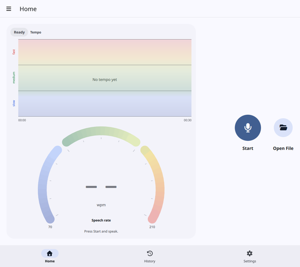
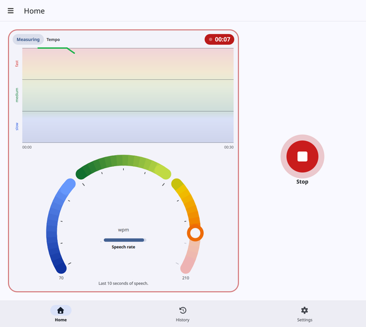
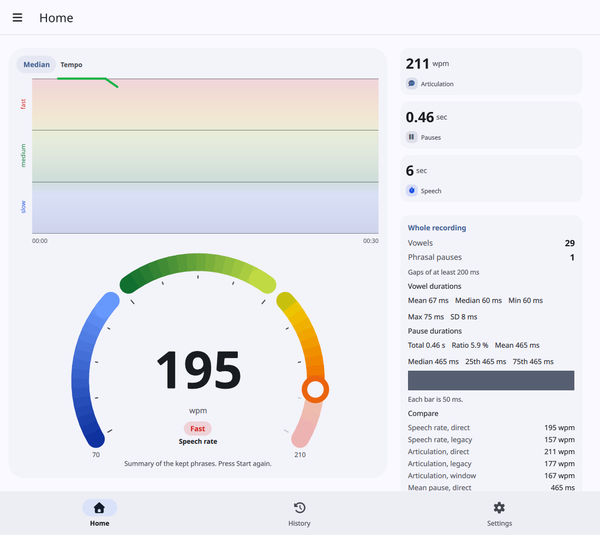
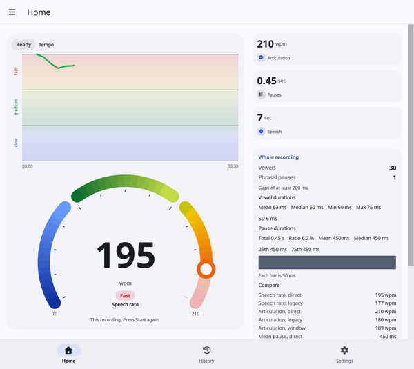
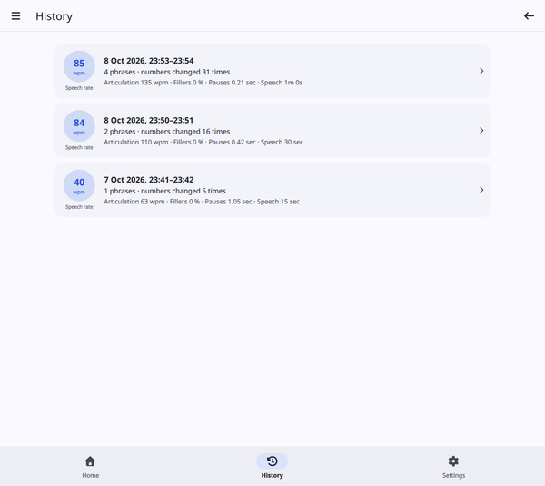
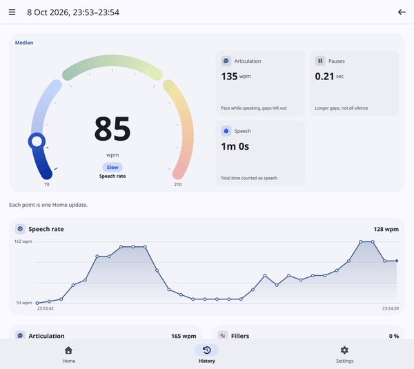
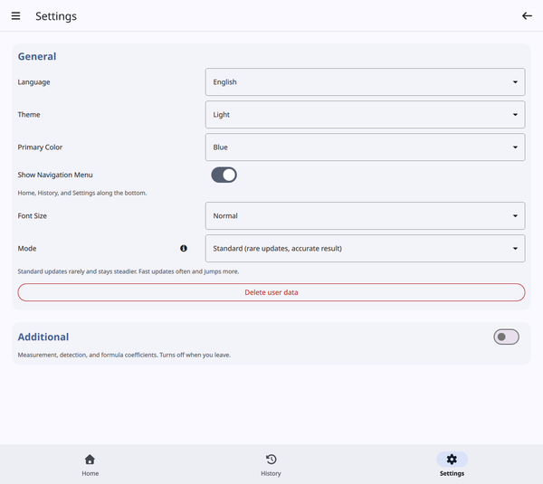

# Speech Rate Meter 2

Speech Rate Meter 2 shows how fast you are speaking, in words per minute. It does not recognize words, and the recording stays on this device.

While you speak, the arcs and the tempo chart follow you. The numbers appear when you press **Stop**.

## Record a session

1. Open **Home**.
2. Press **Start** and speak as you normally would.
3. Press **Stop** when you are finished.

Home before **Start**. The tempo chart is empty, the gauge has no number, and **Start** is on screen. The chip reads **Ready**.

Until the first point appears, the chart says that everything is working and that the tempo shows up about two seconds after you start speaking. The line grows from the left. When it reaches the right edge, older points slide off.

A session in progress. The gauge card has a red outline, the badge shows the time, and the chart is moving. The centre of the arc has no number. This picture keeps 30 seconds of the chart so a short take is easy to see. The default **Chart window** is 5 minutes.

A halo around **Stop** follows the microphone. If you are speaking and the halo stays still, the microphone is not being heard.

With **Detect speech automatically** on, stay quiet for a moment after **Start** while the room is measured, then speak. A pause ends the phrase and saves it. The next phrase starts when you speak again. With it off, measuring starts as soon as you press **Start**, a pause does not end the phrase, and the recording is saved in 15-second parts.

Silence and background noise are not counted as speech. A phrase shorter than one second is not saved.

On any page except Settings, a red **Recording** chip in the toolbar shows the same time. Tap it to return to Home. The timer does not reset between phrases. Opening **Settings** stops the session first. A phrase shorter than one second is dropped. A longer one is saved.

After **Stop**: a number in the arc, the chip naming the summary (by default **Median**), the value cards that are switched on, and the **Whole recording** card.

After **Stop** the arc shows the summary of the phrases that were kept. The chip names that summary. The default is **Median**. The cards you left on in Settings appear beside it, and the tempo chart stays above the arcs. **Listen**, to the left of **Start**, plays the recording. Press it again to stop playback. The audio is deleted when you leave the app, unless **Keep recording files** is on.

## Open a recording

On a computer, **Open File** sits to the right of **Start**. It measures one WAV file and does not save a session. PCM and 32-bit float files are accepted, including other sample rates, stereo, and files with extra header data. The app converts them to 8000 Hz mono before measuring. **Listen to test** plays that recording. If a file cannot be read, the page says why. Android does not show this button.

A measured WAV. The hint reads **This recording**. **Whole recording** compares both speech rates and all three articulation estimates. **Listen to test** plays the file.

## What you see on Home

**The gauge.** The arc runs from **Slow** to **Fast** and is split equally into Slow, Average, and Fast. By default it shows speech rate. The printed number is the measured pace. The marker stays inside the Slow–Fast range, so a pace outside that range still prints its real number while the marker sits at the end.

**The tempo chart.** Each point is one live update, at the same pace the arcs are using. The chart keeps the last **Chart window** (5 minutes by default). It uses the same three bands as the gauge and labels them slow, medium, and fast, written upward. It does not repeat the Slow and Fast numbers. Those numbers stay under the ends of the arc.

**The chip** in the corner of the gauge tells you the state:

- **Ready** — press **Start** and speak.
- **Listening** — the app is waiting for speech. Speak when you are ready.
- **Too short** — keep speaking. A phrase under one second is not kept.
- **Measuring** — the live pace is following your recent speech.
- **Too short to save** — that phrase was not saved.
- **Microphone blocked** — allow the microphone, then press **Start** again.
- After **Stop**, the chip names the **Session summary**. The default name is **Median**.

**Value cards** stay hidden while you record. After **Stop** and after **Open File** they appear for the measures you turned on in Settings. A pace already drawn on the gauge is not repeated as a card.

**Whole recording** is a separate card. It measures the entire take, including silence between phrases, and shows both speech-rate estimates, all three articulation estimates, and how the pause lengths are spread out.

## What the numbers mean

- **Speech rate** is the overall pace, in words per minute, pauses between words included. This is the number on the gauge by default.
- **Articulation** is the pace while you are actually speaking, with those gaps left out. Also in words per minute. It is usually close to the speech rate, and higher when you leave gaps.
- **Fillers** is how much some sounds are drawn out, such as a long “uh”. It is a percent, not a count of words. Its card is off until you turn **Show Fillers tile** on.
- **Pauses** is the length of the longer gaps, in seconds. It is not the total time you were silent.
- **Speech** is the total time that counted as speech. From one minute the card reads `1m 30s`. While you record, the red badge shows the time since **Start** instead. Silence before speech is detected is not included, and a pause is included only up to the **Pause** setting.

While you record, speech rate, articulation, fillers, and pauses use the **Analysis window**: the most recent speech, 10 seconds by default. At the start of a session the window is only as long as the audio collected so far. They are not a running total from **Start**. **Speech** is that total.

After **Stop**, speech rate, articulation, fillers, and pauses become one summary of every phrase that was kept. **Speech** stays the total. History uses the same summary.

### How a pace is chosen

You can leave these at their defaults.

**Speech rate method**

- **Direct** (the default) leaves out silence before the first sound and after the last. Pauses between words stay in the time.
- **Legacy** uses the whole buffer, including that silence at the ends.

**Articulation method**

- **Direct** (the default) takes the same span as Direct speech rate and removes the silent gaps inside it. With no such gaps, the two Direct numbers match.
- **Window** removes those same gaps from the whole measured buffer, and keeps silence at the ends. It can sit below the speech rate.
- **Legacy** keeps an older estimate.

**Pauses** in Direct mode is the average length of those longer gaps. Legacy shows the older score.

The **Whole recording** card shows both speech rates and all three articulation estimates, so you can compare them without changing the method.

## History

**History** lists each finished session, newest first. A row shows the date, the speech rate, how many phrases were kept, how many times the numbers changed, and the articulation, fillers, pauses, and speech time for that session.

The session list. Each row has a speech-rate badge, the date, the phrase count, and the other four results.

Open a row to see the same summary as Home, then the value cards Settings leaves on, then a chart for each measure. Each point on those charts is one Home update.

An opened session: the gauge with the summary, the value cards, and the chart of each Home update.

An opened file is not listed here, because **Open File** does not save a session.

## Settings

**General**, with **Additional** off. Measurement and the formula controls stay hidden until you turn Additional on.

**General** is how the app looks, and which preset it uses.

- **Language**, **Theme**, **Primary Color**, and **Font Size**.
- **Show Navigation Menu** adds Home, History, and Settings along the bottom. The menu button stays in the toolbar.
- **Mode** is **Standard (rare updates, accurate result)** or **Fast (frequent updates, lower accuracy)**. Standard uses a 60-second analysis window and 12 updates a minute, so each number covers more speech. Fast uses a 5-second window and 120 updates a minute, so the number follows you sooner and jumps more. Choosing a mode again restores it. Language, theme, color, font size, the navigation bar, **Keep recording files**, and the speech-detection thresholds stay as they are.
- **Delete user data** removes saved sessions and any recording files still kept in `data/records`. Your settings stay.

**Additional** opens **Measurement** and the formula controls. The switch turns off when you leave the app. The values stay as you left them.

**Measurement** is how a session is read. The question mark beside a control explains that control in more detail.

- **Analysis window** is how many recent seconds of speech the live pace uses. Shorter reacts faster and jumps more. The shortest value is 3 seconds. Standard mode uses 60 seconds. Fast mode uses 5 seconds.
- **Updates per minute** is how often the pace is recalculated and how often the tempo chart gains a point. The shortest value is 1, once a minute. Standard mode uses 12, once every 5 seconds. Fast mode uses 120, twice a second.
- **Chart window** is how many seconds the tempo chart keeps. The default is 300 seconds (5 minutes). The range is 30 to 1800 seconds.
- **Pause** is how much silence ends a phrase and saves it. The default is 2 seconds. This is used only when **Detect speech automatically** is on. A phrase longer than 15 seconds is cut at the next pause, or at 15 seconds.
- **Phrasal pause** is the shortest silent gap that counts as a pause inside the pace calculation. The default is 200 ms. Short stop closures in a word are not counted.
- **Detect speech automatically** waits for speech and lets a pause end the phrase. Off, measuring starts at **Start** and the recording is saved in 15-second parts.
- **Session summary** is how the kept phrases are combined after **Stop**. **Median**, the default, takes the middle phrase. A longer phrase counts more if you pick a weighted summary. **Speech** is always the total time, whichever you pick. History uses the same choice, and the chip on Home shows its name.
- **Gauge** chooses the pace on the arc: **Speech rate**, **Articulation rate**, or **Both**. With both, speech rate is the outer arc and articulation is the inner arc.
- **Show Speech rate tile**, **Show Articulation rate tile**, **Show Fillers tile**, **Show Pauses tile**, **Show Speech tile**, and **Show Whole recording tile** choose which cards appear after **Stop**, after **Open File**, and on a saved session. A pace already on the gauge cannot also be a card, and that switch stays off. Fillers is off until you turn it on. The others are on by default.
- **Slow** and **Fast** are the ends of the gauge, in words per minute. The defaults are 70 and 210.
- **Use all readings** is on by default. Each tempo-chart point is then the middle of every live reading since **Start**, and **Gauge median** cannot be changed. The arcs still use **Gauge median**. Turn it off and each chart point matches the arcs, with the tip at zero while the arcs are at rest.
- **Gauge median** is how many latest readings the gauge takes the middle of. The default is 3, so one jump moves the arc less. Set it to 1 to show the current reading. After **Stop** the gauge shows the session summary, not this median.

Under the same **Additional** switch, the detection and formula controls follow **Measurement**, including **Keep recording files** and **Shortest vowel**. Leave them as they are unless you are comparing methods. **Keep recording files** stays as you set it. On, each phrase is left as a WAV file in `data/records`. Off, those files are deleted when you leave the app.

A change applies to the next phrase.

## If something looks wrong

- **You are speaking and nothing moves.** The halo around **Stop** should grow with your voice. If it stays still, the microphone is not being heard. If the chip says **Microphone blocked**, allow the microphone and press **Start** again.
- **The arc has no number.** That is normal while a session is running. Press **Stop** to see the summary.
- **The chip says Listening.** The app is waiting for speech. Speak when you are ready. With automatic detection, give it a quiet moment first so it can measure the room.
- **The chip says Too short to save.** That phrase was under one second, so it was not kept. Speak a little longer.
- **The chart says there is no tempo yet.** Keep speaking. The first point appears about two seconds after speech starts.
- **There is no Open File button.** That button is only on a computer.

## Other pages

- **User Guide** is this text.
- **Privacy Policy** describes what stays on the device.
- **Open-source licences** lists the components built into the application.
