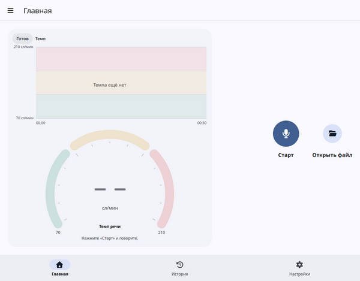
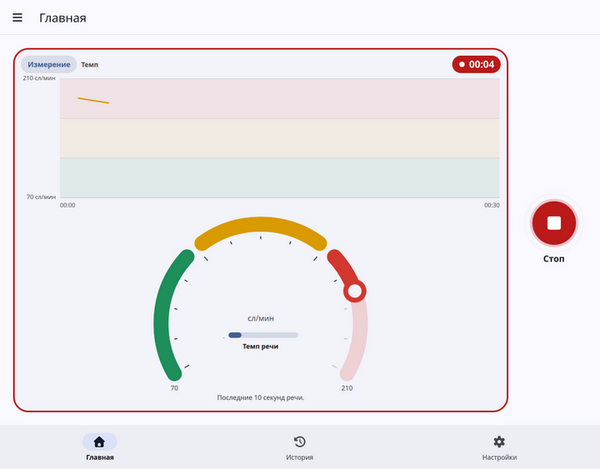
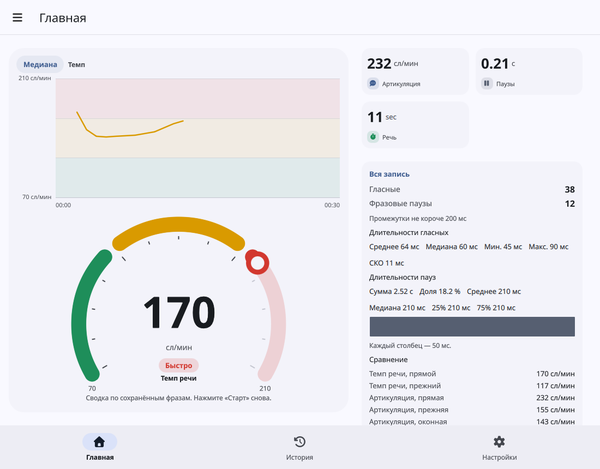
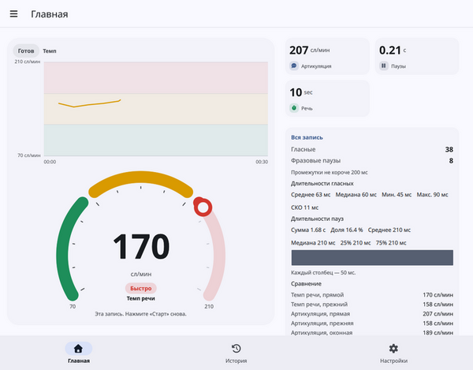
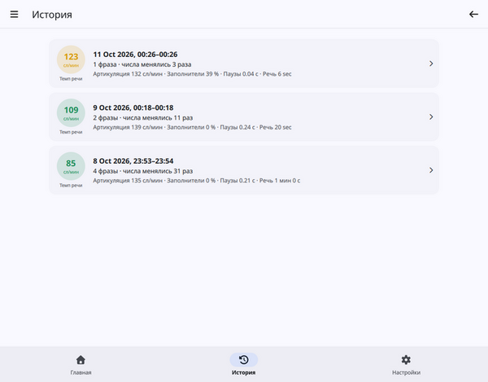
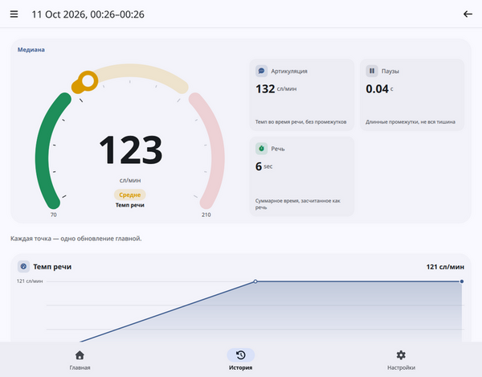
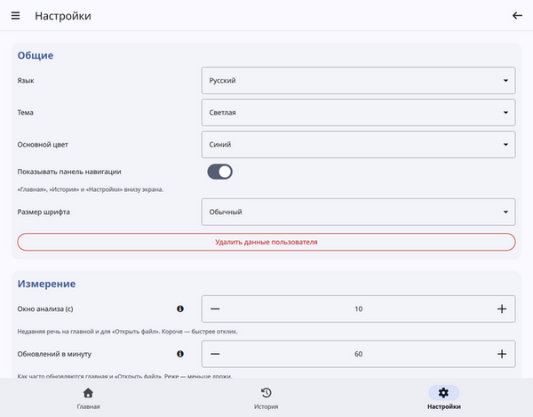

# Измеритель темпа речи 2

«Измеритель темпа речи 2» показывает, насколько быстро вы говорите, в словах в минуту. Слова он не распознаёт, а запись остаётся на этом устройстве.

Пока вы говорите, дуги и график темпа следуют за вами. Числа появляются, когда вы нажимаете **Стоп**.

## Запись сеанса

1. Откройте **Главная**.
2. Нажмите **Старт** и говорите как обычно.
3. Нажмите **Стоп**, когда закончите.

Главная до нажатия **Старт**. График темпа пуст, на шкале нет числа, на экране кнопка **Старт**. Метка читается **Готов**.

Пока первой точки нет, график пишет, что всё в порядке и темп появится примерно через две секунды после начала речи. Линия растёт слева. Когда она доходит до правого края, старые точки уходят влево.

Идущий сеанс. Карточка шкалы обведена красным, метка показывает время, график движется. В центре дуги числа нет. На этом снимке график хранит 30 секунд, чтобы короткая запись была хорошо видна. По умолчанию **окно графика** — 5 минут.

Ореол вокруг **Стоп** следует за микрофоном. Если вы говорите, а ореол неподвижен, микрофон не слышит звук.

Если включено **Автоопределение речи**, после **Старт** немного помолчите: приложение измеряет комнату, а затем говорите. Пауза завершает фразу и сохраняет её. Следующая начнётся, когда вы снова заговорите. Если переключатель выключен, измерение начинается сразу при нажатии **Старт**, пауза фразу не заканчивает, а запись сохраняется частями по 15 секунд.

Тишина и фоновый шум не считаются речью. Фраза короче одной секунды не сохраняется.

На любой странице, кроме настроек, в панели стоит красная метка **Запись** с тем же временем. Нажмите её, чтобы вернуться на главную. Между фразами таймер не сбрасывается. Переход в **Настройки** сначала останавливает сеанс. Открытая фраза короче секунды отбрасывается, более длинная сохраняется.

После **Стоп**: число в дуге, метка со сводкой (по умолчанию **Медиана**), включённые карточки и карточка **Вся запись**.

После **Стоп** дуга показывает сводку сохранённых фраз. Метка называет эту сводку. По умолчанию это **Медиана**. Рядом появляются карточки, которые вы оставили включёнными в настройках, а график темпа остаётся над дугами. **Слушать** слева от **Старт** проигрывает запись. Повторное нажатие останавливает воспроизведение. Звук удаляется при выходе из приложения, если не включено **Сохранять файлы записи**.

## Открыть запись

На компьютере справа от **Старт** есть кнопка **Открыть файл**. Она измеряет один WAV-файл и не сохраняет сеанс. Подходят PCM и 32-битный float, в том числе с другой частотой, стерео и дополнительными блоками в заголовке. Перед измерением файл приводится к 8000 Гц, один канал. **Слушать тест** проигрывает эту запись. Если файл прочитать нельзя, на странице написано, почему. На Android этой кнопки нет.

Измеренный WAV. Подсказка читается **Эта запись**. **Вся запись** сравнивает оба темпа речи и все три оценки артикуляции. **Слушать тест** проигрывает файл.

## Что видно на главной

**Шкала.** Дуга идёт от **Медленно** до **Быстро** и делится поровну на Медленно, Средне и Быстро. По умолчанию она показывает темп речи. Напечатанное число — измеренный темп. Указатель остаётся внутри диапазона «медленно–быстро»: если темп выходит за край, число всё равно печатается как есть, а указатель стоит на краю.

**График темпа.** Каждая точка — одно живое обновление, с тем же темпом, что и дуги. График хранит последние секунды **окна графика** (по умолчанию 5 минут). Он использует те же три полосы, что и шкала, и подписывает их «медленно», «средне» и «быстро» снизу вверх. Числа он не повторяет: они остаются под концами дуги.

**Метка** в углу шкалы говорит, в каком состоянии приложение:

- **Готов** — нажмите **Старт** и говорите.
- **Слушаю** — приложение ждёт речь. Говорите, когда будете готовы.
- **Слишком коротко** — продолжайте. Фраза короче секунды не сохраняется.
- **Измерение** — живой темп следует за недавней речью.
- **Слишком короткая** — эта фраза не сохранена.
- **Микрофон заблокирован** — разрешите микрофон и снова нажмите **Старт**.
- После **Стоп** метка называет **сводку сеанса**. По умолчанию это **Медиана**.

**Карточки** скрыты, пока идёт запись. После **Стоп** и после **Открыть файл** они появляются для тех показателей, которые вы включили в настройках. Темп, уже нарисованный на шкале, карточкой не повторяется.

**Вся запись** — отдельная карточка. Она меряет всю запись, включая тишину между фразами, и показывает обе оценки темпа речи, все три оценки артикуляции и то, как распределены длины пауз.

## Что означают числа

- **Темп речи** — общий темп в словах в минуту, вместе с паузами между словами. По умолчанию это число на шкале.
- **Артикуляция** — темп, пока вы действительно говорите, без этих промежутков. Тоже в словах в минуту. Обычно она близка к темпу речи и выше, когда вы делаете паузы.
- **Заполнители** — насколько некоторые звуки затянуты, например долгое «э-э». Это процент, а не число слов. Карточка выключена, пока вы не включите **Показывать плитку заполнителей**.
- **Паузы** — длина более долгих промежутков, в секундах. Это не всё время тишины.
- **Речь** — суммарное время, засчитанное как речь. От одной минуты карточка читается как `1 мин 30 с`. Пока идёт запись, красная метка вместо этого показывает время с момента **Старт**. Тишина до обнаружения речи не входит, а пауза входит только до настройки **Пауза**.

Во время записи темп речи, артикуляция, заполнители и паузы считаются по **окну анализа**: последней речи, по умолчанию 10 секунд. В начале сеанса окно равно уже собранному звуку, если его меньше. Это не нарастающий итог с момента **Старт**. **Речь** — этот итог.

После **Стоп** темп речи, артикуляция, заполнители и паузы становятся одной сводкой всех сохранённых фраз. **Речь** остаётся суммой. История использует ту же сводку.

### Как выбирается темп

Эти параметры можно оставить по умолчанию.

**Метод темпа речи**

- **Прямой** (по умолчанию) отбрасывает тишину до первого звука и после последнего. Паузы между словами остаются во времени.
- **Прежний** берёт весь буфер, включая эту тишину по краям.

**Метод артикуляции**

- **Прямой** (по умолчанию) берёт тот же промежуток, что и прямой темп речи, и убирает из него тихие промежутки. Если таких промежутков нет, оба прямых числа совпадают.
- **Оконный** убирает те же промежутки из всего измеренного буфера и оставляет тишину по краям. Оценка может быть ниже темпа речи.
- **Прежний** оставляет старую оценку.

**Паузы** в прямом методе — средняя длина этих более долгих промежутков. Прежний метод показывает старую оценку.

Карточка **Вся запись** показывает оба темпа речи и все три оценки артикуляции, поэтому их можно сравнить, не меняя метод.

## История

**История** показывает законченные сеансы, сначала новые. В строке — дата, темп речи, число сохранённых фраз, сколько раз менялись числа, а также артикуляция, заполнители, паузы и время речи этого сеанса.

Список сеансов. В строке — значок темпа речи, дата, число фраз и остальные четыре результата.

Откройте строку, чтобы увидеть ту же сводку, что на главной, затем карточки, которые оставляют включёнными настройки, а затем график по каждому показателю. Каждая точка на этих графиках — одно обновление главной.

Открытый сеанс: шкала со сводкой, карточки и график каждого обновления главной.

Открытый файл сюда не попадает: **Открыть файл** сеанс не сохраняет.

## Настройки

Раздел **Общие** и первые параметры в разделе **Измерение**. **Дополнительно** выключено.

**Общие** — как выглядит приложение.

- **Язык**, **Тема**, **Основной цвет** и **Размер шрифта**.
- **Показывать панель навигации** добавляет «Главная», «История» и «Настройки» вдоль нижнего края. Кнопка меню в панели остаётся.
- **Удалить данные пользователя** стирает сохранённые сеансы и файлы записи, которые ещё лежат в `data/records`. Сами настройки остаются.

**Измерение** — как читается сеанс. Знак вопроса рядом с параметром объясняет его подробнее.

- **Окно анализа** — сколько последних секунд речи использует живой темп. Короче — быстрее реагирует и сильнее скачет. Минимум 3 секунды. По умолчанию 10.
- **Обновлений в минуту** — как часто пересчитывается темп и как часто график получает новую точку. По умолчанию 60, раз в секунду. Минимум 1, раз в минуту.
- **Окно графика** — сколько секунд хранит график темпа. По умолчанию 300 секунд (5 минут). Диапазон — от 30 до 1800 секунд.
- **Пауза** — какая тишина завершает фразу и сохраняет её. По умолчанию 2 секунды. Используется, только когда включено **Автоопределение речи**. Фраза длиннее 15 секунд обрезается на следующей паузе или на 15-й секунде.
- **Фразовая пауза** — кратчайший тихий промежуток, который считается паузой внутри расчёта темпа. По умолчанию 200 мс. Короткие смычки внутри слова не считаются.
- **Автоопределение речи** ждёт речь и позволяет паузе завершить фразу. Если выключено, измерение начинается со **Старт**, а запись сохраняется частями по 15 секунд.
- **Сводка сеанса** — как сохранённые фразы объединяются после **Стоп**. **Медиана**, значение по умолчанию, берёт среднюю фразу. Более длинная фраза весит больше, если выбрать взвешенную сводку. **Речь** всегда остаётся суммарным временем. История использует тот же выбор, и метка на главной показывает его название.
- **Шкала** выбирает темп на дуге: **Темп речи**, **Темп артикуляции** или **Оба**. При обоих темп речи — внешняя дуга, артикуляция — внутренняя.
- **Показывать плитку темпа речи**, **Показывать плитку темпа артикуляции**, **Показывать плитку заполнителей**, **Показывать плитку пауз**, **Показывать плитку речи** и **Показывать плитку всей записи** выбирают, какие карточки появляются после **Стоп**, после **Открыть файл** и в сохранённом сеансе. Темп, уже показанный на шкале, карточкой быть не может, и этот переключатель остаётся выключенным. Заполнители выключены, пока вы их не включите. Остальные по умолчанию включены.
- **Медленно** и **Быстро** — края шкалы, в словах в минуту. По умолчанию 70 и 210.
- **Все значения** включено по умолчанию. Тогда каждая точка графика темпа — середина всех живых значений с момента **Старт**, а **Медиану шкалы** изменить нельзя. Дуги по-прежнему используют **Медиану шкалы**. Если выключить, каждая точка графика совпадает с дугами, а кончик в покое становится нулём.
- **Медиана шкалы** — сколько последних значений шкала берёт и показывает их середину. По умолчанию 3, поэтому один скачок двигает дугу меньше. Значение 1 показывает текущее значение. После **Стоп** шкала показывает сводку сеанса, а не эту медиану.

**Дополнительно** открывает параметры обнаружения и формулы, включая **Сохранять файлы записи** и **Кратчайшую гласную**. Оставьте их как есть, если вы не сравниваете методы. Переключатель **Дополнительно** выключается при выходе из приложения. **Сохранять файлы записи** остаётся как вы его задали. Включённое оставляет каждую фразу файлом WAV в `data/records`. Выключенное удаляет эти файлы при выходе из приложения.

Изменение действует на следующую фразу.

## Если на экране что-то не так

- **Вы говорите, а ничего не движется.** Ореол вокруг **Стоп** должен расти вместе с голосом. Если он неподвижен, микрофон не слышит звук. Если метка говорит **Микрофон заблокирован**, разрешите микрофон и снова нажмите **Старт**.
- **На дуге нет числа.** Так и должно быть, пока сеанс идёт. Нажмите **Стоп**, чтобы увидеть сводку.
- **Метка говорит «Слушаю».** Приложение ждёт речь. Говорите, когда будете готовы. При автоопределении сначала дайте ему тихую секунду, чтобы измерить комнату.
- **Метка говорит «Слишком короткая».** Фраза была короче секунды и не сохранилась. Говорите чуть дольше.
- **График пишет, что темпа ещё нет.** Продолжайте говорить. Первая точка появляется примерно через две секунды после начала речи.
- **Нет кнопки «Открыть файл».** Эта кнопка есть только на компьютере.

## Другие страницы

- **Руководство пользователя** — этот текст.
- **Политика конфиденциальности** — что остаётся на устройстве.
- **Лицензии открытого ПО** — компоненты, из которых собрано приложение.
